# Approved Issue automation

This MVP turns an approved Issue into a reviewable PR. It never merges, deploys,
uses self-hosted runners, or touches the local development PostgreSQL server.
All workflow jobs use disposable GitHub-hosted `ubuntu-24.04` runners.

## Architecture and trust boundaries

```mermaid
flowchart LR
  A[agent-ready label added] --> B[Trusted read-only authorization]
  B --> C[Disposable Codex worker]
  C --> D[Untrusted bounded patch]
  D --> E[Fresh verifier runner]
  E --> F[Credential-free offline test container]
  F --> G[Immutable verified patch and trusted digest]
  G --> H[Fresh trusted publisher runner]
  H --> I[Short-lived GitHub App token]
  I --> J[Agent branch and PR]
  J --> K[Independent CI and human review]
```



`.github/workflows/issue-to-codex.yml` owns authorization and concurrency. It
calls `.github/workflows/publish-agent-pr.yml` as a reusable workflow after
verification succeeds. Reusable-workflow inputs come directly from the isolated
authorization and verification jobs, not a worker-generated manifest. This
avoids granting trust to worker-authored authorization metadata or introducing
a broadly privileged `workflow_run` artifact consumer. The publisher is a fresh
job/runner, not a later step on the Codex machine. No secrets are inherited.

The authorization job requires all of these conditions:

1. The event is `issues: labeled`, the added label is exactly `agent-ready`, and
   the object is an open Issue rather than a PR.
2. The labeler's live repository permission is `write`, `maintain`, or `admin`.
   A label, issue body, comment, author association, or username alone does not
   grant authorization.
3. The Issue author is `exedeehuashan`, or `exedeehuashan` explicitly approves
   another author's Issue by applying the label while holding trusted access.
4. The live Issue contents match the labeling event. The latest active label
   event belongs to that labeler.
5. The workflow executes on the current default-branch commit. A run rerun is
   rejected; remove/reapply the label to authorize a new attempt.
6. Neither `agent/issue-<number>` nor a PR for that branch already exists.

Authorization outputs bind the issue title/body/author hash, label event ID,
labeler, number, and baseline SHA. Publication independently rechecks live
permissions, label state/event, Issue contents, duplicates, and default-branch
SHA. Removing/reapplying the label or changing the Issue invalidates the prior
approval. The default branch advancing fails safely; relabel against its new
baseline. Whole-pipeline concurrency is one run per Issue with no cancellation
of an active run. GitHub ref creation is non-overwriting, providing a final
duplicate guard. API or pagination errors deny authorization.

## Credentials and privileges

| Boundary | Credentials and capabilities |
| --- | --- |
| Authorization | `GITHUB_TOKEN`: contents, issues, PRs read only |
| Codex worker | Contents-read checkout; only dedicated `OPENAI_API_KEY` through the official action proxy; artifact-upload capability |
| Verifier controller | Contents/actions read; no OpenAI or App secret |
| Candidate test container | No GitHub/OpenAI credentials or Actions control files; network disabled; cache/source read only |
| Publisher | `GITHUB_TOKEN`: contents/actions/PRs read and issues write for the result comment; App token: contents write and PRs write |
| Independent PR CI | Contents-read token; no injected publisher, OpenAI, or production secrets |

The Codex action is pinned to the reviewed `v1` commit and CLI `0.138.0`, using
`permission-profile: ':workspace'` and `safety-strategy: drop-sudo`. It uses a new
Codex home and rejects active repository `.codex`, `.agents`, and `.mcp.json`
configuration pending a separate security review. Issue data enters the prompt
as JSON and is never interpolated into shell source. Repository instructions
remain untrusted; `AGENTS.md` is advisory, not the enforcement boundary.

All checkouts disable persisted credentials. The worker never receives a write
token, publisher environment secret, production credential, or privileged
publisher process. Only data collection/upload follows Codex on that runner;
it is deliberately treated as compromised output. The collector is preserved
outside the writable workspace, but that does not make its result trusted.

## Patch and artifact policy

The default allowlist is deliberately narrow:

- `backend/src/main/java/**/*.java`
- New `backend/src/test/java/**/*.java` files; existing tests cannot be modified
  or deleted, so the independent baseline suite remains intact.
- `docs/**/*.md` and root `README.md`

Every `AGENTS.md` and `SKILL.md` is protected, including nested files. Hidden
paths, sensitive filenames, build/dependency files, application configuration,
Flyway migrations, frontend code, workflows, automation controllers, deployment
files, and credentials are denied. Changes outside this policy require a
separate human-authored PR; an Issue cannot expand the policy.

Validation rejects absolute/traversing/noncanonical paths, ambiguous or
mismatched Git headers, duplicate entries, renames/copies, binaries, symlinks
(including existing parent symlinks), submodules, executable modes, and files
that are not regular UTF-8 text. Limits: 50 changed files, 256 KiB per resulting
file, 2 MiB patch, and one expected ZIP member. Archive path traversal,
additional files, unsafe modes, malformed ZIPs, and size violations fail before
extraction. Artifact IDs must belong to the current run and have the expected
name. GitHub credentials are never forwarded to signed storage URLs.

The verifier applies the patch to a clean, fixed baseline using Git's index
checks, compares resulting paths, scans full resulting files for private keys,
OpenAI/GitHub/AWS token shapes and suspicious literal credential assignments,
then emits a canonical patch. The publisher repeats that validation and checks
the SHA-256 digest supplied by the trusted verifier. Agent summaries and claimed
test results are never used for authorization or PR claims.

Pattern-based scanning cannot detect every encoded or novel secret. No real
secrets should exist in repository content. Prompt injection is not assumed
solved by text filtering; privilege isolation and deterministic policy are the
primary controls. Human review remains necessary for semantic correctness.

## Independent testing

The verifier warms Maven dependencies by testing the trusted baseline in a
restricted container with network access and no credentials. It then tests the
candidate with `mvn -o clean verify` in a fresh container with network disabled
and a read-only dependency cache. Newly required dependencies fail offline and
must be introduced in a human-reviewed build PR first.

The Maven image is pinned by digest. Containers run as the host's non-root UID,
with all capabilities dropped, `no-new-privileges`, a read-only root filesystem,
resource/PID limits, and disposable `/work` and `/tmp` storage. A read-only
passwd/group mapping supports PostgreSQL on GitHub's numeric runner UID.
Temporary storage allows execution because embedded PostgreSQL extracts native
binaries. Containers receive only the repository, dependency cache, and identity
mapping; no sockets, host home, credentials, Actions environment/control files,
or writable evidence files are mounted. Test stdout is informational; the
trusted controller uses the container exit status. Failed tests prevent the
verified-artifact upload and publisher invocation.
Actions logging-command interpretation is disabled around container stdout with
a random host-only stop token, so candidate output is treated as log data.

The App creates the branch and PR through GitHub APIs, which trigger the existing
Backend CI and Automation Security CI workflows independently. Unlike a push
using the workflow's `GITHUB_TOKEN`, App-authored events can start these workflows.
Configure branch protection to require both CI jobs and human approval. CI must
not inject production secrets into PR jobs, and the App must not have a rule
bypass or auto-merge permission. Actual event delivery must be checked in the
credentialed GitHub smoke test.

## Setup

1. Review and merge this automation through the normal human process. Issue
   events only use workflows installed on the default branch. This implementation
   does not push, install secrets, configure repository settings, or activate
   GitHub resources itself.
2. Create the `agent-ready` repository label. Apply it only after reviewing the
   Issue body for a small task within the allowlist.
3. Create a GitHub environment named `codex-worker`, restricted to the default
   branch. Store a dedicated, budget-limited OpenAI project API key there as
   `OPENAI_API_KEY`. Do not reuse production keys or store the App private key in
   this environment. Do not place production secrets in environments used here.
4. Register a GitHub App under your user/organization settings. It does not need
   a webhook or subscribed events. Grant **only repository Contents: read/write,
   Pull requests: read/write, and the mandatory Metadata: read**. Grant no
   Workflows, Actions, Administration, Secrets, Deployments, or organization
   permissions. Install it for this repository only. No installation ID secret
   is needed; the official token action resolves the repository installation.
5. Record the App ID (not the client ID), and generate/download its PEM private
   key. Create environment `agent-publisher`, restricted to the default branch.
   Add environment variable `AGENT_APP_ID` and environment secret
   `AGENT_APP_PRIVATE_KEY` containing the PEM. Never commit either private key
   material or a token. Required environment reviewers are recommended where
   available; they add a human checkpoint before the publisher runner starts.
6. Ensure repository Actions policy allows the pinned official actions and
   GitHub-hosted Ubuntu runners. The publisher's `GITHUB_TOKEN` must be allowed
   `issues: write` for its result comment; contents remain read-only for that
   token. The App installation supplies contents/PR writes independently.
7. Protect the default branch with required Backend CI and Automation Security
   CI checks and human review. Protect the automation/policy files with review
   rules appropriate to your repository; do not allow the App to bypass them.

The token action restricts each installation token to this repository and
explicitly requests only contents/PR writes. It revokes the short-lived token
in its post-job cleanup. The publisher mints it only after independent validation.
It never checks out the generated branch, invokes Maven, evaluates agent output,
or runs agent-generated scripts.

## Local tests (no App or OpenAI credentials)

```sh
python3 -I -B -m unittest discover -s .github/automation/tests -v
bash -n .github/automation/isolated-maven.sh
git diff --check
# Optional: use a locally installed actionlint.
actionlint -shellcheck=

# Docker Desktop must be able to see this ignored directory.
export RUNNER_TEMP="$PWD/.local-verifier"
bash .github/automation/isolated-maven.sh warm
bash .github/automation/isolated-maven.sh test
# Confirms isolation and that a deliberate failing JUnit test is rejected.
GH_TOKEN=unit-test-sentinel bash .github/automation/test-isolated-failure.sh
```

Local Python tests mock every publication API; fake tokens are test strings, not
credentials. Local container tests use no keys or production database. They
exercise the same harness as the hosted verifier. `/tmp` bind mounts may not be
shared with Docker Desktop, hence the ignored repository-local cache example.
See [execution evidence](issue-automation-test-results.md) for actual results.

## Credentialed GitHub smoke test

This requires setup above and is intentionally separate from local tests:

1. As `exedeehuashan`, create a small Issue such as adding a Java unit test in a
   new file. Include expected behavior and test expectations.
2. Apply `agent-ready` as a trusted collaborator. Confirm authorization, worker,
   verifier, and publisher run on separate hosted runners.
3. Confirm the PR targets the default branch, uses `agent/issue-<number>`, contains
   `Refs #<number>` and a test evidence link, and appears in an Issue comment.
4. Confirm both independent PR CI checks actually run; do not merge automatically.
5. Remove/reapply the label and confirm the existing branch/PR causes a skip.
6. Using test Issues, confirm an unauthorized author without owner approval,
   an untrusted labeler, forbidden workflow edits, and a new failing JUnit test
   never create a new PR. Test missing-key behavior in a dedicated test setup;
   do not remove or rotate production credentials for this test.
7. Confirm removing the label or editing the Issue while generation is running
   blocks publication. Confirm missing App setup blocks publication safely.

## Failure recovery and troubleshooting

| Symptom | Expected behavior / action |
| --- | --- |
| No run | Check exact label addition, workflow on default branch, Actions enabled; comments/Issue creation do not trigger it |
| Authorization denied | Check live labeler permissions, author policy, active approval event, and Issue open state |
| Workflow rerun denied | Remove/reapply label to issue a fresh authorization |
| Duplicate skipped | Existing branch or any PR for it is the idempotency marker; no automatic deletion, overwrite, or force-push |
| Issue changed / approval revoked | Review the new requirements and reapply label |
| Default branch advanced | Review/relabel for the latest baseline; no automatic rebase of tested output |
| Missing OpenAI key | Configure only the codex-worker environment; no fallback or privileged PR |
| Codex sandbox failure | Use a fresh hosted Ubuntu runner; do not switch to unsafe mode or a local runner |
| Repository agent configuration present | Obtain a separate security review; do not disable the check in the Issue |
| Artifact rejected | Check size, expected member/name/run, patch policy; never bypass validation |
| Credential scanner rejected | Remove the literal/sensitive file; review false positives in a human-authored policy PR |
| Maven fails offline | Dependencies must be warmed from baseline; build/dependency changes require human review |
| PostgreSQL startup failure | Check non-root UID mapping and executable container /tmp; never run tests as root |
| Missing App / 403 / 404 | Verify App ID, PEM, installation on this repository, permissions, environment restrictions, and Actions policy |
| Branch exists but PR/comment failed | Partial publication is possible across GitHub API calls; maintainer inspects the verified run and branch and completes recovery manually; reruns do not overwrite it |
| CI not triggered | Verify PR/branch were authored by the App, App is installed, Actions is enabled, and checks are required; GITHUB_TOKEN is not a publisher fallback |

Failures produce explicit job logs and a pipeline summary; publication requires
successful authorization, generation, verification, and independent publisher
checks. No issue comment is attempted from untrusted/failed worker code. Missing
credentials are failures rather than empty-success fallbacks. Auth/API errors,
expired artifacts, malformed patches, and test timeouts cannot authorize a PR.

## Costs and operational trade-offs

OpenAI API requests consume the dedicated project's billed token budget; runner
minutes, container/dependency downloads, artifact storage, and independent push
and PR CI also consume GitHub quotas. No new paid infrastructure is provisioned.
Pricing and included quotas depend on your plans; use the providers' dashboards
and project spend controls rather than treating a workflow timeout as a spending
cap. The worker is limited to 25 minutes, verifier to 25, publisher to 10, and
each Maven container to 15. Artifacts expire after one day.

A run makes authorization/recheck API calls plus roughly one blob write per
changed file (at most 50), tree/commit/ref/PR writes, and one comment. API rate
limits and revoked access fail closed. Fresh runners and no shared Actions caches
reduce cross-run contamination at the cost of repeated dependency downloads and
baseline testing. Independent push/PR CI can run twice for the same commit.

This is a bounded automation path, not proof of generated-code correctness.
Potentially malicious Java runs only in disposable containers; publisher
validation parses candidate text but never executes it. Kernel/container escape,
upstream action/image compromise, novel secret encodings, and the small race
between final authorization checks and GitHub writes remain residual risks.
Pin updates need human review. Protecting the default-branch control plane and
reviewing generated PRs are required operational controls.
GitHub App Contents write is repository-wide, not path-scoped. The strict path
restriction is enforced by the trusted validator/controller; protecting that
control plane and the publisher environment is essential.

## References

- [Official Codex Action guidance](https://learn.chatgpt.com/docs/github-action)
- [Official action inputs and safety documentation](https://github.com/openai/codex-action)
- [GitHub workflow event triggering and GITHUB_TOKEN limitations](https://docs.github.com/en/actions/how-tos/write-workflows/choose-when-workflows-run/trigger-a-workflow)
- [Official GitHub App token action](https://github.com/actions/create-github-app-token)
