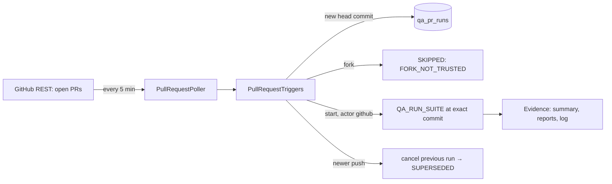

# P11: Pull request triggered testing

Status: 方案 4 moves from manual to event-driven testing. EAHP polls GitHub for
open pull requests of registered projects and runs their trigger suites on every
new head commit. It only reads from GitHub; posting results back to pull
requests is a separate, credential-dependent step.

## Architecture Explanation

- **Triggers as data** (`qa_pr_triggers`): which suites run for pull requests.
  `online-shop/backend-unit` is enabled. The Docker-access integration suite is
  seeded disabled, because every push would otherwise create an approval request.
- **Polling, not webhooks**: a local EAHP needs no public endpoint. The poller is
  off by default (`EAHP_GITHUB_POLL_ENABLED`), runs every 5 minutes, works
  anonymously for public repositories, and accepts an optional read-only
  `EAHP_GITHUB_TOKEN`. Only `https://github.com/owner/repo` URLs are polled.
- **One row per (PR, head commit, suite)** in `qa_pr_runs` deduplicates work and
  records the outcome: `PENDING`, `STARTED`, `SUPERSEDED` or `SKIPPED` with a reason.
- **One task per (PR, suite)**, titled `PR #47 backend-unit: <title>`. Each new head
  commit is a new run on that task, pinned to the commit (`ref` = full SHA, so no
  ref resolution and no race with later pushes). Runs are created by the `github`
  actor, visible in the audit trail.
- **Supersede**: a newer push marks older pending rows `SUPERSEDED` and cancels the
  previous commit's active run; the new commit starts on the next cycle, once the
  cancellation has completed.
- **Forks are never run automatically**: their head commit is untrusted code. The
  row is recorded as `SKIPPED` / `FORK_NOT_TRUSTED` so it is visible.
- **Untrusted text**: PR titles and branch names have control characters removed
  and are length-bounded before they become task titles.
- `GET /api/v1/qa/pull-requests` and `GET /api/v1/qa/github-polls` (VIEWER) feed the
  console's **Pull requests** page: poll health, each commit's trigger outcome and
  a link to its run.

## Trade-off Analysis

Polling adds up to five minutes of latency and uses the GitHub API rate limit
(anonymous: 60 requests per hour, one request per project per cycle). Webhooks
would be immediate but need a reachable endpoint and secret verification, which
is the production direction once EAHP runs on a server.

Superseding cancels the older run instead of letting both finish. That matches
how CI usually treats pull requests and keeps the single worker free, at the cost
of no result for intermediate commits.

## Production Considerations

- Starting runs for pull requests executes code from the repository's branches.
  Only register repositories whose contributors are trusted; forks are excluded,
  but anyone with push access to the repository can still trigger runs.
- Poll errors are stored per project. GitHub I/O errors keep their message
  (for example `GitHub returned HTTP 403`); any internal error is stored only as
  `POLL_FAILED`, so SQL or stack details never reach the API.
- Closed pull requests are not cleaned up; their rows and tasks remain as history.
- V10 adds `qa_pr_triggers`, `qa_pr_runs` and `qa_github_polls`.

## Bilingual Interview Q&A

Q: Why poll GitHub instead of using webhooks?

中文：本地或内网部署没有公网入口，轮询不需要暴露任何端口，也不用管理 webhook 密钥。代价是几分钟的延迟和 API 限额，服务器部署后可以换成 webhook。

English: A local or internal deployment has no public endpoint; polling exposes
nothing and needs no webhook secret. The cost is minutes of latency and API rate
limits; a server deployment can switch to webhooks.

Q: Why are fork pull requests not tested automatically?

中文：Fork 的代码来自仓库外部，自动执行等于让外部人员在测试环境运行任意代码。平台记录这些 PR，但需要人工决定是否运行。

English: Fork code comes from outside the repository; running it automatically
lets outsiders execute arbitrary code in the test environment. EAHP records them
but leaves running them to a human decision.

## Verification

`PullRequestTriggerApiTest` (8 tests, fake GitHub client) covers: a same-repository
PR starting one run pinned to its head commit with the `github` actor, and
deduplication on the next poll; a new push cancelling the previous run and
starting on the same task; start rejection recorded as skipped; forks never run;
only enabled triggers and suites, with Docker suites waiting for approval; GitHub
errors recorded and cleared; untrusted titles cleaned, non-GitHub projects not
polled, malformed SHAs ignored; API authentication and parameter validation.
The console has a test for the Pull requests page.

## Observed local results

Deployed with `scripts/deploy.sh` and `EAHP_GITHUB_POLL_ENABLED=true` (backup taken,
smoke test passed). The first poll found `online-shop` PR #47 (same repository),
head commit `4dfe646`, matching GitHub, and started `backend-unit` at that commit.
Audit: `github:RUN_CREATED`, then the worker's claim, dispatch and result.

The run **failed with `TESTS_FAILED`**: exit 1, 40 tests, 1 error. PR #47 adds
`CatalogMigrationTest`, a Testcontainers test, to a module covered by the
Docker-free unit suite, so it errors without Docker. This is the same issue P8
found with `IdentityPersistenceTest`, now caught on a pull request before merge:
online-shop's unit layer keeps acquiring Docker-dependent tests that only pass
because its own CI runner happens to have Docker. The fix belongs in online-shop
(tag or separate Testcontainers tests, or declare suites in the repository), not
in another exclusion in EAHP.
