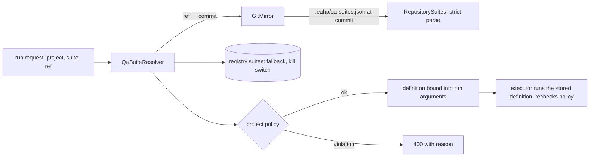

# P12: Test suites declared in the project's repository

Status: projects can declare their QA suites in their own repository, versioned
with the code; EAHP keeps the per-project policy that every suite must satisfy.
This removes the root cause of the stale suite definitions found in P8 and P11.

## Why

The `backend-unit` selection was copied from online-shop's CI into EAHP's registry.
Twice it went stale: `IdentityPersistenceTest` on main (P8), then
`CatalogMigrationTest` in PR #47 (P11), now also on main. Each time EAHP correctly
reported a failure, but the right fix lives with the code that adds the test, not
in another EAHP migration.

## Architecture Explanation



- **Project policy** (`qa_projects`): whether repository suites are read and from
  which file, allowed runner images, whether Docker access and network egress may
  be granted, and the maximum timeout. A repository file can never exceed it.
- **Resolution** at run start: the ref is resolved to a commit; the suites file is
  read at that exact commit. A repository suite overrides a registry suite with the
  same key; a registry suite marked disabled blocks its key from every source
  (administrator kill switch). Registry suites remain the fallback when the file is
  absent.
- **The resolved definition** (source, image, argv command, report directories,
  network, Docker access, maximum time) is stored in the run's arguments. The
  approval digest therefore covers the exact command at that commit, and the
  executor runs what was approved even if the file changes later. At execution
  the policy is checked again (`SUITE_POLICY_CHANGED`).
- **Strict parsing** of the untrusted file: schema version 1, at most 20 suites,
  64 KiB, unknown fields and duplicate JSON keys rejected, keys and images
  validated, argv entries bounded with no control characters, report directories
  relative without `..`, timeouts 30–3600 s. Errors name the problem and are
  returned as 400; an invalid file never silently falls back for that suite.
- `GET /api/v1/qa/projects/{key}/suites?ref=` lists the suites available at a ref
  with their source and whether the file was found, absent, disabled or invalid.
  The console's Run test suite form uses it, labels repository suites `[repo]`
  and shows an invalid file's error. The Test projects page shows each policy.
- Pull request triggers may name suites that exist only in the repository file;
  if the suite is missing at a PR's commit, the trigger is skipped with
  `SUITE_UNAVAILABLE` (or `INVALID_SUITES_FILE`).

## Trade-off Analysis

Letting the repository define commands moves trust to people with push access.
That is acceptable because a test command already runs the repository's own code
(build plugins and tests); what must stay with EAHP administrators is what can
harm the host or the budget: runner images, Docker access, network and time.
That is exactly the policy layer.

Reading the file at run start costs a mirror fetch and a `git cat-file` per run
request, and an unreachable repository now rejects the request (400) instead of
failing later. Rejecting early is safer than guessing which suites exist.

## Production Considerations

- Keep `allowed_images` short and pinned to exact tags.
- `allow_docker_access` should stay off for projects that do not need
  Testcontainers; when on, Docker suites still require approval.
- V11 adds the policy columns (online-shop: repository suites on, Docker access
  allowed, 40-minute maximum) and lets PR triggers name repository-only suites.

## Suggested file for online-shop

Committing this as `.eahp/qa-suites.json` in online-shop would make EAHP use the
project's own selection. The longer-term fix is to tag Testcontainers tests
(`@Tag("docker")`) and select with `-DexcludedGroups=docker` / `-Dgroups=docker`
instead of listing classes:

```json
{
  "schemaVersion": 1,
  "suites": [
    {
      "key": "backend-unit",
      "name": "Backend unit and slice tests",
      "description": "Everything that needs no Docker. Testcontainers tests are tagged docker.",
      "image": "maven:3.9.11-eclipse-temurin-17",
      "command": ["mvn", "-B", "-ntp", "verify", "-DexcludedGroups=docker"],
      "reportDirs": ["target/surefire-reports", "target/failsafe-reports"],
      "network": "egress",
      "dockerAccess": false,
      "timeoutSeconds": 1800
    },
    {
      "key": "backend-integration",
      "name": "Backend PostgreSQL integration tests",
      "description": "All Testcontainers tests, including identity and catalog migrations.",
      "image": "maven:3.9.11-eclipse-temurin-17",
      "command": ["mvn", "-B", "-ntp", "verify", "-Dgroups=docker", "-Dsurefire.failIfNoSpecifiedTests=false"],
      "reportDirs": ["target/surefire-reports", "target/failsafe-reports"],
      "network": "egress",
      "dockerAccess": true,
      "timeoutSeconds": 2400
    }
  ]
}
```

## Bilingual Interview Q&A

Q: Why let the repository declare its test suites at all?

中文：测试的增加和调整与代码变更一起发生。把套件定义放在仓库里，同一个提交同时修改代码和测试选择，平台按该提交读取，就不会出现平台配置落后于代码的情况。

English: Tests change together with code. With suites declared in the repository,
the same commit changes code and test selection, and the platform reads them at
that commit, so the platform's configuration cannot fall behind the code.

Q: How do you stop a repository file from granting itself more power?

中文：权限相关的部分（镜像、Docker 访问、网络、时长）由平台按项目配置的策略强制，仓库只能在策略范围内选择；解析结果写入运行参数并进入审批摘要，执行前再次校验策略。

English: Everything that grants power (images, Docker access, network, time) is
enforced by the platform's per-project policy; the repository can only choose
within it. The resolved definition is stored in the run arguments, covered by the
approval digest, and policy is rechecked before execution.

## Verification

`QaSuiteToolApiTest` (16 tests) adds: a repository suite overriding the registry,
bound into the run and executed even after the file disappears; repository-only
suites and the catalog showing both sources; policy limits (timeout, duplicate
fields, disallowed image, Docker access, network egress, registry kill switch);
eight kinds of invalid files rejected with reasons while the catalog still lists
registry suites; execution rechecking policy. `PullRequestTriggerApiTest` adds a
trigger for a suite missing at the commit. Frontend: 17 tests, including
repository-labelled suites and invalid-file reporting.

## Observed local results

Deployed with `scripts/deploy.sh` (backup taken, smoke test passed). For
online-shop `main` (`1ca9ae5`) the catalog reported the suites file as absent and
offered the registry suites. A `backend-unit` run resolved through the registry
fallback (`definition.source = registry`) and failed with `TESTS_FAILED`
(40 tests, 1 error): `CatalogMigrationTest` is now on main, so the registry's
class list is stale again. Committing the suggested `.eahp/qa-suites.json` (with
Testcontainers tests tagged) to online-shop is the fix this phase enables.
