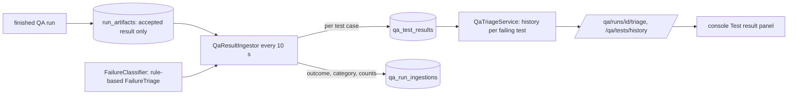

# P13: Test-result history and failure triage

Status: first step of 方案 4's failure analysis. Every finished QA run's stored
reports become per-test history, and every failure gets a category, a plain
explanation and a history label. The classification is rule-based and
deterministic; a model-based classifier can be added behind the same interface.

## Why

In P8, P11 and P12 the real failures were diagnosed by reading console logs by
hand: each time a Testcontainers test running in a Docker-free suite. EAHP now
reaches that diagnosis itself and says whether a failure is new, persistent or
flaky.

## Architecture Explanation

- **Ingestion is separate from execution.** A job reads `junit-reports.zip`,
  `summary.json` and `console.log` from the run's stored artifacts. Artifacts
  exist only for accepted results (P7 fencing), so stale workers never add
  history. Each run is ingested once in its own transaction, and runs that
  finished earlier are backfilled automatically.
- **Per-test rows** (`qa_test_results`): project, suite, commit, class, name,
  status, duration, exception type, message and category. XML is parsed with the
  same protections as P8 (no DTDs or external entities, bounded sizes).
- **Classification** (`FailureClassifier`, implemented by `FailureTriage`):
  - per failed test: `ENVIRONMENT_DOCKER`, `ENVIRONMENT_NETWORK`, `TIMEOUT`,
    `ASSERTION`, `UNEXPECTED_EXCEPTION`, `UNKNOWN`, with environment causes taking
    precedence over the exception type that carries them;
  - per run: `BUILD_COMPILATION`, `BUILD_DEPENDENCIES`, `RUN_STOPPED`, `RUNNER`,
    `NO_TESTS`; for test failures, the most common test category.
  Each category has a one-paragraph explanation returned with the triage.
- **History** per failing test, from up to 20 earlier results in the same project
  and suite (never results from later runs): `FIRST_SEEN`, `NEW_FAILURE` (the
  previous result passed), `PERSISTENT`, or `FLAKY` (the same commit also passed),
  plus the last commit where it passed and recent failure counts.
- APIs (VIEWER): `GET /api/v1/qa/runs/{runId}/triage`,
  `GET /api/v1/qa/tests/history?project=&suite=&testClass=&testName=`.
- Console: the Test result panel shows "Why it failed", and each failing test's
  category and history badge. Until ingestion finishes it shows the summary list.

## Trade-off Analysis

Rules first, models later: rules are cheap, explainable and reproducible, and they
already cover the failures seen so far. Their limit is coverage: a new kind of
failure lands in `UNKNOWN`. A model-based classifier can propose categories and
explanations, but it should complement the rules and never change the recorded
test outcome.

History is computed at query time from stored rows rather than stored per
failure. It always reflects all ingested runs up to the triaged run, at the cost
of a small query per failing test (bounded to 100 failures and 20 results each).

## Production Considerations

- `qa_test_results` grows with every run (one row per test case). It needs a
  retention policy before long-term use; indexes cover per-run and per-test
  history lookups.
- Ingestion runs with the worker (`EAHP_WORKER_ENABLED`) every 10 seconds, 20 runs
  per cycle. A run whose evidence cannot be read is recorded as
  `INGESTION_FAILED` and not retried automatically.
- Messages are stored truncated (500 characters) and stack excerpts are used for
  classification only, not stored.
- V12 adds `qa_run_ingestions` and `qa_test_results`.

## Bilingual Interview Q&A

Q: Why classify failures with rules before using a model?

中文：规则可复现、可解释、成本低，已经覆盖了实际遇到的失败类型。模型可以在规则之后补充解释，但不能改变记录下来的测试结果。

English: Rules are reproducible, explainable and cheap, and they already cover the
failures seen in practice. A model can add explanations later, but it must never
change the recorded test result.

Q: How do you tell a flaky test from a real regression?

中文：看同一个测试的历史：同一提交既通过又失败是不稳定；上一次通过、这次失败是新失败；之前就一直失败是持续失败。

English: Look at the test's history: passing and failing on the same commit is
flaky; passing before and failing now is a new failure; failing before as well is
persistent.

## Verification

- `FailureTriageTest`: test and run classification rules, including environment
  causes taking precedence.
- `QaSuiteToolApiTest` (18 tests) adds: ingestion once per run; a passing baseline,
  then `NEW_FAILURE` with the last passing commit, `FLAKY` on the same commit,
  `PERSISTENT` on the next commit, and `ENVIRONMENT_DOCKER` / `FIRST_SEEN` for a
  Docker error; the history API and its validation; a compilation failure
  categorized from the console log; unfinished runs not ingested.
- Related backend suites: 103 tests pass. Frontend: 17 tests pass, including the
  triage view.

## Observed local results

Deployed with `scripts/deploy.sh` (backup taken, smoke test passed). On startup the
job backfilled all 8 QA runs in the deployment, including two started meanwhile by
the PR poller for online-shop PRs #49 (passed, 51 tests) and #50 (failed):

| Commit | Suite | Outcome | Category | Failing test history |
|---|---|---|---|---|
| `39a6a0b` | backend-unit | TESTS_FAILED | ENVIRONMENT_DOCKER | IdentityPersistenceTest: first seen |
| `39a6a0b` | backend-unit, backend-integration | PASSED (×3) | — | — |
| `4dfe646` (PR #47) | backend-unit | TESTS_FAILED | ENVIRONMENT_DOCKER | CatalogMigrationTest: first seen |
| `6c1f844` (PR #49) | backend-unit | PASSED | — | — |
| `1ca9ae5` (main) | backend-unit | TESTS_FAILED | ENVIRONMENT_DOCKER | CatalogMigrationTest: persistent (2/2) |
| `1b228a0` (PR #50) | backend-unit | TESTS_FAILED | ENVIRONMENT_DOCKER | CatalogMigrationTest: persistent (3/3) |

Every real failure was classified as a Docker-dependent test in a Docker-free
suite, matching the manual diagnoses from earlier phases. The first deployment
counted later runs into a run's history; history is now bounded to earlier runs.
