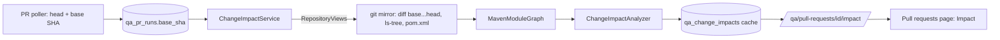

# P14: Change impact analysis for pull requests

Status: advisory. For every pull request commit EAHP reports what changed, which
Maven modules that affects (directly or through dependencies) and which test
classes are in scope, with warnings about untested changes. It does not yet
change which tests run.

## Architecture Explanation

- The poller now records each pull request's **base commit** (`base.sha` from
  GitHub). It is updated while the PR is open, because the base moves as the
  target branch advances.
- **Changed files** come from `git diff --name-only base...head` in the project's
  mirror (relative to the merge base, as GitHub shows a PR diff).
- **Module graph**: every `pom.xml` at the head commit is parsed (no DTDs or
  external entities); a module's groupId may be inherited from its parent; only
  dependencies on other modules of the same build count, so external libraries
  and plugin declarations are ignored.
- **Impact**:
  - modules containing changed files (`CHANGED`), plus every module that depends
    on them, transitively (`DEPENDS_ON_CHANGED`);
  - a root `pom.xml` change affects the whole build (`BUILD_CHANGED`);
  - files outside every module (frontend, CI, docs) are listed separately;
  - test classes in affected modules follow Surefire/Failsafe naming
    (`Test*`, `*Test`, `*Tests`, `*TestCase`, `*IT`); helpers such as fixtures
    are not counted;
  - notes call out changed modules without tests of their own, and changes
    outside the backend build;
  - repositories without a Maven build report `buildSystem: unknown` instead of
    guessing.
- Results are cached per (project, base, head): the pair fully determines the
  answer. Errors are cached for 10 minutes so a broken repository is not fetched
  on every request. The poller precomputes up to 5 new impacts per cycle; the API
  computes on demand otherwise.
- `GET /api/v1/qa/pull-requests/{id}/impact` (VIEWER). The console's Pull requests
  page has an Impact toggle per row.
- The analysis code reads the repository only through `RepositoryView`, so it is
  unit-tested in memory and other build systems can be added beside Maven.

## Trade-off Analysis

Module-level impact is coarse but reliable: Maven's own dependency graph decides
what can break. Class-level selection (call graphs, coverage maps) would select
fewer tests but can miss reflection, configuration and resources. That is why
this phase only reports scope; using it to skip tests needs evidence first, and
full regression should still run periodically even then.

Reading every `pom.xml` and the full file list per commit pair costs a few git
commands; caching per commit pair keeps that to once per PR push.

## Production Considerations

- Impact is only as good as the build's declared dependencies. Modules that
  interact at runtime without a Maven dependency (HTTP calls, shared databases)
  are not linked; contract tests cover those.
- Pull requests seen before this phase have no base commit (`BASE_UNKNOWN`) until
  the next poll while they are still open.
- V13 adds `qa_pr_runs.base_sha` and `qa_change_impacts`.

## Bilingual Interview Q&A

Q: Why compute impact at module level rather than per class?

中文：模块依赖由构建系统声明，结果可靠；类级别分析更精细，但容易漏掉反射、配置和资源文件。所以先用模块级别给出范围和风险，等有足够数据证明准确后再用于减少测试。

English: Module dependencies are declared by the build, so the result is
reliable. Class-level analysis is finer but can miss reflection, configuration
and resources. Module-level scope comes first; using it to skip tests waits until
data shows it is accurate.

Q: Why diff against the merge base instead of the base branch tip?

中文：基准分支在 PR 打开后还会前进。用合并基点比较，只包含这个 PR 自己的改动，与 GitHub 显示的差异一致。

English: The base branch keeps moving after a PR is opened. Diffing from the merge
base shows only the PR's own changes, matching what GitHub displays.

## Verification

- `ChangeImpactAnalyzerTest` (5 tests, in-memory repository shaped like
  online-shop): a domain change affecting its dependents with their tests;
  untested changed modules and files outside modules called out; a root POM
  change affecting the whole build; non-Maven repositories reported as unknown;
  POM parsing ignoring external and plugin artifacts and refusing entities.
- `PullRequestTriggerApiTest` (10 tests) adds: base commit stored from GitHub,
  impact computed and cached, errors cached, unknown base, 404 and authentication.
- Frontend: 17 tests, including the Impact toggle. Related backend suites: 96 pass.

## Observed local results

Deployed with `scripts/deploy.sh`; the first poll recorded base commits for the
open online-shop PRs and precomputed their impact. The results match GitHub's own
file lists:

| PR | Changed files | Affected modules | Tests in scope | Notes |
|---|---|---|---|---|
| #50 | 20 | catalog-domain, catalog-application, catalog-adapters-persistence, catalog-api | 5 | `catalog-adapters-persistence` has no tests of its own |
| #49 | 21 | catalog-api, identity-api | 4 | 5 files outside the Maven modules (docs, tasks, `tests/contracts`) |
| #47 | — | — | — | merged before base commits were recorded (`BASE_UNKNOWN`) |

Two observations about online-shop worth acting on: its catalog persistence adapter
has no tests of its own, and PR #49 changes contract tests that no EAHP suite runs
yet (registering the contract suite would close that gap).
