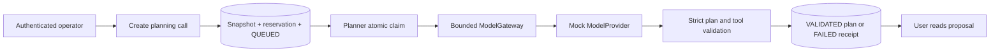

# P4, first milestone: pluggable planning with a Mock Provider

Status: foundation only. No real inference service, credentials or paid calls.
This branch depends on P3 (PR #8), which was still open when work began.

## Architecture Explanation

ModelProvider defines provider/model identity, task input and response/usage.
Only MockModelProvider is configured. It ignores instructions in the task and
returns a fixed local DEMO_REVIEW proposal; it is a deterministic fixture, not
an AI model or a test-quality evaluation.

Planning calls own immutable title/description/task-version snapshots, input
digests, actor, provider/model metadata, deadlines, usage estimates and results.
They do not update task state/version or create AgentRun, ApprovalRequest or
ToolInvocation records. Existing execution and P3 approval remain independent.
There is no plan-to-run conversion endpoint in this milestone. A planning digest
is not an approval credential or a replacement for a run's reviewed digest.

The create transaction locks the task, resolves idempotency before reserving
budget, serializes the UTC daily reservation row and persists the call. Worker
claim uses SKIP LOCKED and a random fencing token. Provider work runs outside the
transaction; completion checks ownership/deadline, usage bounds and a strict JSON
schema against current supported tool metadata before storing a plan. Replayed
requests return the original receipt, not a second provider call.

## Trade-off Analysis

A small Java interface allows later adapters without making EAHP depend on one
vendor. This milestone intentionally rejects configuration for unimplemented
providers instead of returning mock output disguised as live inference.

The default provider executor has two daemon threads, no waiting submission
queue, and explicit rejection on saturation. A separate two-thread scheduler
allows planning waits without serializing the existing run scheduler behind
them. This is a single-process local configuration, not a throughput/HA claim.

Calls are not automatically retried: a timeout cannot prove that an eventual
remote request was not processed or billed. Current token estimates are UTF-8
byte-based approximations with fixed overhead; they are not vendor tokenizers.
The full reservation is retained for the UTC day after success, failure or
queue expiry, trading utilization for conservative, deterministic accounting.
Actual billing and vendor-specific receipts must be designed with the real
provider. Mock costUsd is always zero; a token cap is not a currency spend cap.

## Production Considerations

- Queue deadline: 60 seconds. Invocation timeout: 100–5000 ms (default 2000).
  Stale/expired work becomes FAILED; it is not requeued. Late results cannot
  overwrite terminal receipts. Timed-out provider tasks receive interruption,
  but code ignoring interrupts can occupy the two slots until it stops. New
  submissions then fail PROVIDER_BUSY; no unbounded thread/queue growth occurs.
- A request can reserve at most estimated input plus 2048 output tokens. The
  default daily policy is 20000 reserved tokens, keyed by UTC date in PostgreSQL.
  Task-level idempotency and budget-row locking prevent duplicate reservations
  and concurrent overspend of this local reservation limit. There is no public
  budget reset or request-level override.
- Valid plans have schemaVersion=1, a nonblank summary up to 500 characters, and
  1–5 steps with tool/toolVersion/target/timeoutSeconds only. JSON is capped at
  8192 UTF-8 bytes; duplicate keys, trailing values and all unknown fields fail.
  A model cannot set approval flags, actors, commands or production targets.
  The Mock byte-based output estimate is also capped independently of reported
  usage, so an underreported token field cannot bypass this local size limit.
- Only structurally valid plans and validated usage metadata are stored. Failure
  codes are bounded; provider exceptions/raw invalid responses are not exposed.
  Input snapshots and plan summaries can still contain workspace user data and
  use existing workspace read permissions. There is no tenant isolation.
- Passing schema validation does not establish semantic correctness or solve
  prompt injection. The Mock injection test only proves deterministic behavior
  and that this planning path has no execution authority. A real model needs
  its own evaluation set and data-handling review.
- Plan validation observes current policy. Policy may change afterward, so any
  future execution path must independently revalidate and use P3 approval. Do
  not execute a stored plan directly as shell commands.
- The call receipt is the model-invocation ledger. P3 execution audit remains
  separate; this milestone does not add model events to that run-scoped table.
- V5 adds model_calls and model_daily_budgets; prior migrations remain unchanged.
  Back up before local deployment. Generated credentials and database dumps stay
  outside the repository. No external service is contacted in this milestone.

## API contract

- POST /api/v1/agent-tasks/{taskId}/plans: OPERATOR, required Idempotency-Key and
  JSON object; 202/Location, including idempotent replays.
- GET /api/v1/model-calls/{id}: VIEWER, receipt including status, usage and plan.
- GET /api/v1/agent-tasks/{taskId}/plans: VIEWER, page/size history descending by
  createdAt/id, bounded to 100 items.
- GET /api/v1/model-provider: VIEWER, explicitly mock/realModel=false/networkCalls=false.
- GET /api/v1/model-budget: APPROVER, UTC date, limit/reservation/remaining estimates.

Invalid input: 400; missing resource: 404; conflicting request or active call:
409; reservation exhausted: 429. Provider/validation failures are asynchronous
FAILED receipts fetched with 200, not fake success. Possible codes include
INVALID_PLAN, USAGE_INVALID, OUTPUT_LIMIT, QUEUE_TIMEOUT, PROVIDER_TIMEOUT,
CALL_INTERRUPTED, PROVIDER_BUSY and PROVIDER_ERROR.

## Verification strategy

Run the full existing regression suite and a new real-filter-chain planning
suite with random local test credentials and temporary PostgreSQL. Explicitly
drive the planner in tests. Check snapshots/idempotency, no run/approval side
effects, strict JSON/tool rejection, unknown provider fail-closed configuration,
usage caps, error redaction, timeout, recovery, stale results, concurrent budget
reservation/claim and V4-to-V5 data preservation. Gateway tests use latches to
check interruption and fixed capacity; no paid service or real API key is used.

## Bilingual Interview Q&A

Q: Why separate model planning from tool execution?

中文：模型输出只是建议，可能错误或包含不允许的操作。平台先校验结构与策略，再由独立执行入口检查权限和审批。

English: Model output is a proposal and may be incorrect or unauthorized.
Validate its structure and policy first; execution must independently enforce
permissions and approval.

Q: Why keep a reservation after a timeout?

中文：超时只说明调用方没有及时拿到结果，不能证明供应商没有执行或计费。保留预留量可以避免把不确定调用当成免费。

English: A timeout means the caller did not receive a result in time; it does
not prove the provider did no work or billing. Retaining a reservation avoids
treating ambiguous calls as free.

## Hands-on Verification

1. Authenticate as operator and create a task, retaining its ID.
2. POST its plans endpoint with a new Idempotency-Key and `{}`; expect 202/QUEUED.
3. Poll Location; expect VALIDATED, provider=mock and a DEMO_REVIEW proposal.
4. Verify task state/version and its execution-run history are unchanged.
5. Replay the request; expect the same ID and no extra budget reservation.
6. Change maxOutputTokens under the same key; expect 409.
7. As admin, inspect model-budget and note estimated usage and zero Mock cost.

Next decision: which real inference API to integrate, with what allowed data,
credentials and per-call/daily spending policy. Codex/Claude Code coding-agent
adapters are a separate execution integration, not interchangeable drop-in
model API clients. No provider choice or paid use is inferred from this Mock work.

## Observed results

Maven verify: 190 tests passed, zero failures/errors/skips (137 existing + 43
planning integration + 3 gateway + 7 configuration). Local deployment backed up
the database and old JAR, applied V5, and preserved a prior consumed P3 approval.
HTTP checks confirmed 202/QUEUED → VALIDATED, mock/realModel=false, zero cost,
estimated usage, idempotent replay with no extra reservation, changed-options
409, viewer-write 403 and operator-budget 403. Planning created no execution
runs and left task status/version unchanged. Plan receipt and budget remained
identical after a backend restart. No external inference request was made.
