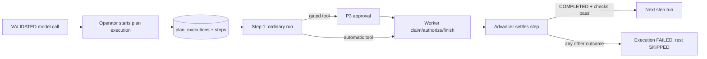

# P5: Executing validated plans through approval gates

Status: closes the plan → approve → execute loop using the Mock Provider and the
existing pure local tools. No real model, credentials or side-effecting tools.

## Architecture Explanation

A plan execution belongs to exactly one VALIDATED model call and copies its steps
(tool, version, target, timeout) into `plan_execution_steps`. Each step becomes a
normal AgentRun created by `RunService.start`. P2 claim fencing, deadlines and
recovery, P3 approval digests, consumption and audit therefore apply unchanged;
P5 adds no new execution path to the Worker and no way to skip an approval.

Only one step run exists at a time, which also satisfies the existing one-active-
run-per-task index. The operator's request launches step 1 in its own
transaction. A scheduled advancer (running with the Worker) settles finished step
runs and launches the next step as the trusted `worker` actor, recording a
`PLAN_STEP_LAUNCHED` audit event on the new run. Run idempotency keys are derived
from the execution and step (`plan-<execution>-<n>`), so a launch cannot be
duplicated.

Before every launch, under the task row lock, the advancer verifies that:

- the task title/description still equal the planning snapshot (TASK_CHANGED);
- the step's tool is still enabled with the same version/target (POLICY_CHANGED);
- the task has no other active run and the derived key is unused (TASK_BUSY).

These checks run before `RunService.start`, so the shared transaction never fails
part-way and one bad execution cannot roll back the advancement batch.

## Trade-off Analysis

Sequencing existing single-step runs was chosen over a multi-step run. A multi-step
run would need step-level digests, approvals, leases and recovery, essentially a
second execution engine. Reusing runs keeps one audited execution path at the cost
of a coarser model: each step is its own run with its own task-summary transitions,
and the task briefly shows the previous step's terminal status before the next
launch (up to one advancer poll interval).

Execution is deliberately non-resumable. A failed, rejected, expired, cancelled or
NEEDS_REVIEW step stops the execution; a plan can be executed only once. Recovering
requires a new planning call, which re-snapshots the task. This avoids guessing
whether an uncertain step should be repeated.

Task content is compared, not task version: run transitions legitimately advance
the version between steps, while a title/description edit would make later steps
operate on input the plan was not produced for.

## Production Considerations

- Starting an execution is an OPERATOR action. It does not approve anything:
  gated steps still need an APPROVER decision on their own digest, and the 30-minute
  approval expiry applies per step.
- Validation happens at start and again before each launch, but policy can still
  change after a run is created. P3's pre-dispatch revalidation remains the final
  check for each step.
- Cancel marks the execution CANCELLED immediately and cancels the current run
  cooperatively. A RUNNING step may finish as CANCELLED shortly afterward; no
  further step is launched either way.
- The advancer processes at most 20 settled steps per poll in one transaction and
  shares the Worker's polling interval. No throughput or multi-node claim is made.
- Plan executions and steps are deleted with their task (cascade), like runs.
  Audit events are not, consistent with P3.
- V6 adds `plan_executions` and `plan_execution_steps`; V1–V5 are unchanged.

## API contract

- POST /api/v1/model-calls/{callId}/executions: OPERATOR, required Idempotency-Key,
  empty JSON object; 202/Location, including idempotent replays.
- GET /api/v1/plan-executions/{id}: VIEWER; status, error code, plan digest and
  steps with their run IDs and current run status.
- GET /api/v1/agent-tasks/{taskId}/plan-executions: VIEWER, page/size only.
- POST /api/v1/plan-executions/{id}/cancel: OPERATOR, idempotent 200.

Errors: invalid key/body 400; missing call/execution/task 404; plan not VALIDATED,
already executed with another key, stale task, policy violation, active run or
active execution 409. Execution error codes: STEP_<run status>, TASK_CHANGED,
POLICY_CHANGED, TASK_BUSY.

## Bilingual Interview Q&A

Q: Why execute each plan step as a separate run?

中文：每个步骤复用已有的运行、审批和审计路径，不需要第二套执行引擎；审批摘要仍然绑定单个步骤的确切输入。

English: Each step reuses the existing run, approval and audit path, so there is
no second execution engine, and each approval digest still binds one step's exact input.

Q: Why not resume a failed plan execution?

中文：失败可能是拒绝、过期或结果不确定。自动继续会掩盖这些信号；重新规划会重新获取任务快照并留下新的记录。

English: A failure may be a rejection, an expiry or an uncertain outcome. Resuming
would hide that signal; re-planning takes a fresh snapshot and leaves a new record.

## Verification

`PlanExecutionApiTest` runs the real security filter chain against embedded
PostgreSQL and drives the Worker and advancer explicitly. It covers ordered
multi-step execution with a gated middle step, per-step approval, actor
attribution, replay and second-key rejection, rejection/timeout/external cancel
stopping the execution, task edits, policy changes and manual runs between steps,
cancel while waiting for approval and while running, start preconditions, one
active execution per task, roles, request validation and history.

Local results: the 14 new tests pass, and the related suites (run, approval,
planning, task edit; 130 tests) pass unchanged. The full `mvn verify` runs in CI.

## Hands-on Verification

1. As operator, create a task and a plan; poll until the model call is VALIDATED.
2. POST its executions endpoint with a new Idempotency-Key and `{}`; expect 202,
   a Location, and step 1 LAUNCHED with a WAITING_APPROVAL run (Mock plans use
   DEMO_REVIEW).
3. Replay the same key; expect the same execution ID. A different key returns 409.
4. Approve the step run's approval as admin with its exact digest.
5. Poll the execution; expect COMPLETED with the step and run COMPLETED.
6. Start another execution and cancel it; expect CANCELLED, and 200 on repeat.

## Observed local results

The local deployment backed up the database (`pre-p5.dump`) and the prior JAR,
then applied V6 with V1–V5 still valid; prior tasks and P3/P4 approvals remained.
HTTP checks against the running backend confirmed: viewer start 403; operator
start 202 with Location; step run waiting for approval with zero invocations;
same-key replay returned the same execution; a different key 409; operator
decision 403 and admin approval 200; execution COMPLETED with the approval
CONSUMED; audit linking operator RUN_CREATED/PLAN_STEP_LAUNCHED, admin approval
and worker dispatch/completion; task summary COMPLETED. A second execution
cancelled while waiting for approval became CANCELLED with its run CANCELLED,
and a repeated cancel returned 200. The completed execution response was
byte-identical after a backend restart.
