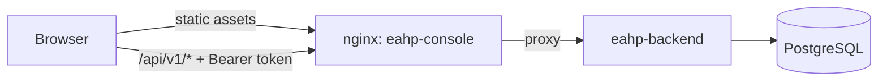

# P6: Web console

Status: a React + TypeScript console over the existing P1–P5 API. It adds no new
capability to the platform; one read-only backend endpoint (`GET /api/v1/me`)
lets the UI adapt to the caller's roles.

## Architecture Explanation

The console is a static Vite build. nginx serves it and proxies `/api` to the
backend, so the browser stays same-origin and the backend needs no CORS policy.
In development, Vite's dev server provides the same proxy.

- Sign-in posts nothing: the console calls `/me` with the pasted token and stores
  it in sessionStorage only after the backend accepts it. Tokens never appear in
  URLs, and closing the tab discards them.
- `/me` returns the identity name and roles. The UI hides actions a role cannot
  perform (task creation and runs for viewers, the approval queue for
  non-approvers). This is a usability layer; the backend still authorizes every
  request, and 401/403 responses are shown with an explanation.
- Pages: tasks (filter, paging, create), task detail (conditional edit with the
  ETag, runs, plans, plan executions), run detail (snapshot, digest, approval,
  steps, invocations, audit), plan execution detail, and the approval queue.
- Detail pages poll every 2 seconds while the tab is visible, which matches the
  backend's polling Worker. Each user action generates a fresh Idempotency-Key.
- Approve/Reject send the run's exact `inputDigest` as `expectedDigest`, so a
  decision only applies to the input the approver was shown.

## Trade-off Analysis

Polling was chosen over server push: runs advance on a 500 ms Worker poll anyway,
and polling needs no new backend infrastructure. The cost is steady read traffic
while pages are open; hidden tabs skip refreshes.

Token paste is the simplest sign-in that matches P3's static local identities.
It is not a substitute for SSO. sessionStorage limits persistence to one tab, but
any script running in the page could read it, so the console ships with a strict
Content-Security-Policy and loads no third-party code at runtime.

No UI library is used. The console is small, and plain CSS with light/dark tokens
keeps the bundle around 190 kB (60 kB gzipped) and avoids dependency churn.

## Production Considerations

- nginx sets CSP (`default-src 'self'`), `X-Frame-Options: DENY`, `nosniff` and
  `no-referrer` on static responses; API responses keep Spring Security's headers.
  Because nginx `add_header` in a location drops inherited headers, the security
  headers live in an include used by each static location.
- Hashed assets are cached for a year; `index.html` is `no-store`, so a redeploy
  takes effect on the next load.
- The deployment listens on 127.0.0.1 only. Exposing it beyond localhost needs TLS
  and the identity review already noted for P3.
- Each new action uses a new idempotency key. A double click is prevented by
  disabling the button while the request is in flight, not by key reuse.

## Verification

- Backend: `IdentityApiTest` checks names and roles for each identity and 401 for
  anonymous and unknown tokens.
- Frontend (Vitest + Testing Library, `fetch` faked): token handling and
  Authorization header, query building, structured errors, ETag edits,
  idempotency keys and decision digests; sign-in rejecting a bad token before
  storing anything; role-based visibility; approving with the exact digest;
  redirecting non-approvers; plan execution rendering. 10 tests pass.
- CI: `Frontend CI` runs typecheck, tests and build on Node 22.

## Observed local results

The console image was deployed next to the existing backend (backend JAR updated
for `/me` after backing up `pre-p6.dump` and `pre-p6.jar`; no migration). Through
the nginx proxy, `/me` returned the operator identity, deep links served the app,
and anonymous API calls returned 401.

A browser walkthrough used a throwaway backend and database with freshly
generated test tokens, so deployment data and credentials were not involved:
an operator created a task, requested a plan, and executed it; the step run
waited for approval; an admin approved it from the queue; the run page then
showed COMPLETED, the consumed approval, one invocation and the full audit trail
(operator creation and launch, admin approval, worker dispatch and completion).
The session survived reloads, and the phone-width layout had no horizontal scroll.
The throwaway environment was removed afterward.
