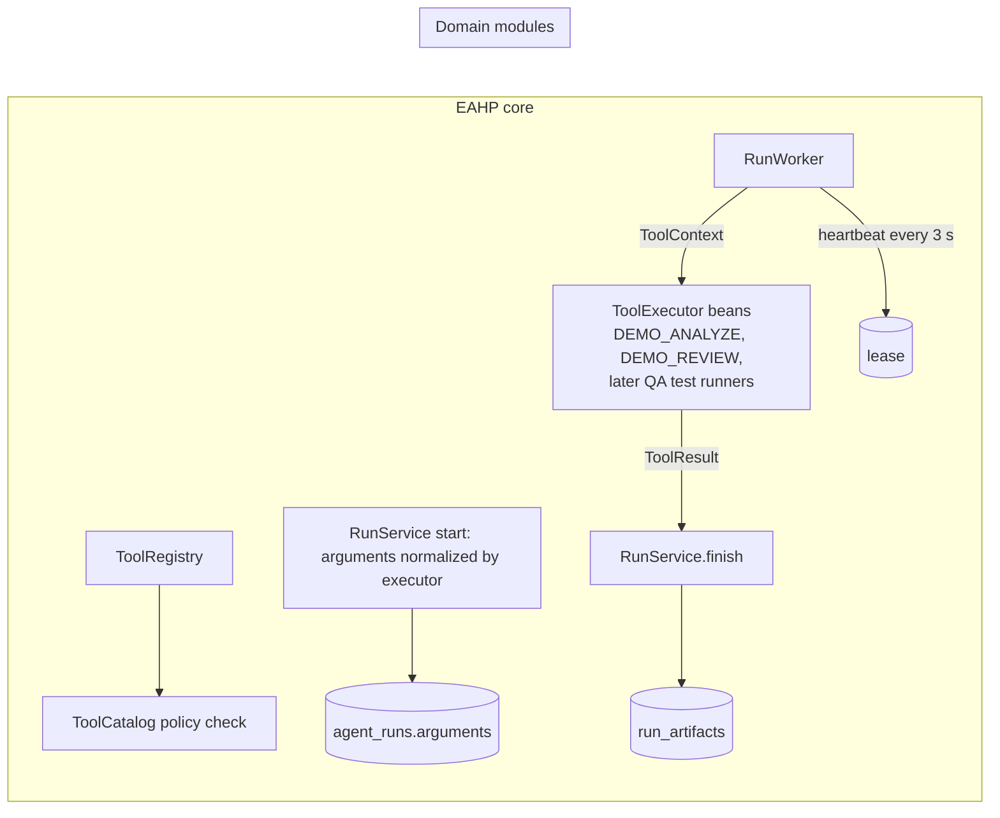

# P7: Tool plugin boundary and artifact evidence

Status: generic EAHP capability. Prepares the platform for domain agents such as the
QA agent (方案 4) without adding any domain logic to the core. The only registered
tools are still the two pure demo tools.

## Architecture Explanation

- **ToolExecutor** is the plug-in contract: name, version, target, approval and retry
  policy, argument normalization, and `execute(ToolContext)`. Domain modules contribute
  executors as Spring beans; the core never references a specific domain.
- **ToolRegistry** collects executors at startup and rejects duplicates or malformed
  contracts. **ToolCatalog.require** now accepts a tool only when an enabled database
  definition matches its executor exactly, so configuration can disable a tool but
  never weaken its approval gate or create an executable tool.
- **Arguments**: runs accept an optional `arguments` object. The tool's executor
  validates and normalizes it; the platform stores canonical JSON (sorted keys). The
  arguments are part of idempotency and, when present, of the approval digest, so
  an approver approves exact arguments. Digests of argument-free runs are unchanged.
- **ToolResult**: success or failure, an output summary and artifacts. A failure
  ends the run FAILED with the tool's own code and output kept as evidence. Codes
  that would impersonate platform decisions (`WORKER_LOST`, `APPROVAL_*`, ...) become
  `TOOL_FAILED`. Exceptions still produce a sanitized `TOOL_FAILED` with no output.
- **Artifacts** (reports, logs) are stored in the same transaction that accepts the
  result, linked to the tool invocation and attempt, with SHA-256 and size. A stale
  or expired claim cannot publish artifacts. Downloads are always attachments with
  `nosniff` and a sandboxing CSP.
- **Lease heartbeat**: the worker renews the 10-second lease every 3 seconds while a
  tool runs, so long tools (test suites) are not mistaken for lost workers. Renewal
  never revives an expired or superseded claim. `ToolContext.stopRequested()` turns
  true on cancellation, deadline expiry or loss of the claim.

## Trade-off Analysis

Executors are Spring beans rather than dynamically loaded plug-ins. Adding a tool is
a code change reviewed like any other, which matches the security model: no runtime
path can introduce executable code. Dynamic loading can come later if a domain needs
it, but would need signing and isolation.

Artifacts are stored in PostgreSQL with hard limits (20 per result, 5 MiB each,
20 MiB total). This keeps evidence transactional with the result and needs no new
infrastructure. Large reports, videos or traces will need an object store; the API
exposes only metadata, digests and a download endpoint, so storage can change
behind it.

Plans (P4/P5) still carry no arguments, so tools that require arguments cannot
appear in a plan; the plan validator and the plan advancer both enforce this.

## Production Considerations

- V7 replaces the fixed tool list check with a name-format check, adds
  `agent_runs.arguments` (TEXT, max 16 KiB) and `run_artifacts`. V1–V6 are unchanged.
- Allowed artifact media types: text/plain, application/json, application/xml,
  application/zip, application/octet-stream. Invalid names, types, duplicates or
  sizes fail the run with `ARTIFACT_INVALID` or `ARTIFACT_LIMIT` and store nothing.
- Output summaries are truncated at 64 Ki characters.
- Artifacts are readable by VIEWER, like run outputs. Logs may contain sensitive
  data, so tools must redact secrets before returning them.
- A tool that ignores `stopRequested()` keeps running after cancellation; its result
  is then discarded by claim fencing. Tools with external effects must stop promptly
  and be idempotent.
- Retention: artifacts are deleted with their run or task. There is no time-based
  retention policy yet.

## Bilingual Interview Q&A

Q: Why does the database tool definition have to match the code exactly?

中文：工具是否可执行、是否需要审批由代码决定并经过评审。数据库只能停用工具，不能放宽审批或新增工具，避免配置变更绕过安全边界。

English: Code defines what a tool does and how it is governed, and it is reviewed.
The database can only switch a tool off, so a configuration change cannot loosen
approval or introduce an executable tool.

Q: Why store artifacts in the same transaction as the result?

中文：只有当前有效领取的结果才会被接受。证据与状态同时提交，避免出现有报告但状态不对，或者过期 Worker 写入证据的情况。

English: Only the current claim's result is accepted. Committing evidence with the
status means no orphaned reports and no evidence from an expired worker.

## Verification

`ToolPluginApiTest` (13 tests) registers test-only executors and covers: canonical
arguments and artifact download headers/digests; failing results kept as FAILED with
evidence; spoofed codes and exceptions sanitized; artifact limits and invalid names;
argument validation and idempotency; approval digests binding arguments and tamper
detection; code-owned policy; stale claims unable to publish; lease renewal and stop
signal; plans rejecting argument-requiring tools; unchanged argument-free digests.

The existing run, approval, planning and plan-execution suites (118 tests) pass
without modification. Full `mvn verify` runs in CI.

## Next

P8 adds the first QA domain executor: running a registered project's predefined
test suite (starting with `online-shop`) in an isolated container, returning the
real exit code, JUnit reports and logs as artifacts.
