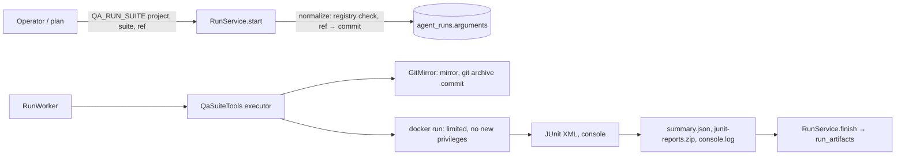

# P8: QA suite runner (方案 4, first real loop)

Status: first domain module on top of EAHP. A registered project's predefined test
suite runs at an exact commit in a disposable container, and the run returns the
real exit code, JUnit reports and logs as evidence. This completes the remaining
方案 4 Sprint 1 acceptance criteria AC-05 (real exit code, timestamps, report
references) and AC-06 (failures are never reported as success).

## Architecture Explanation

- **Registry as data** (`qa_projects`, `qa_test_suites`): repository URL, default
  ref, and per suite the runner image, an argv command (never shell text), report
  directories, network mode, Docker access flag and maximum timeout. `online-shop`
  is seeded with `backend-unit` and `backend-integration`, mirroring its own CI
  jobs. New projects are rows, not code. `GET /api/v1/qa/projects` lists them.
- **Two tools, split by privilege**: `QA_RUN_SUITE` accepts only suites without
  Docker access. `QA_RUN_PRIVILEGED_SUITE` accepts only suites that need the Docker
  socket (Testcontainers) and therefore requires P3 approval. A suite cannot be
  run through the wrong tool.
- **Arguments** `{project, suite, ref?}` are normalized to `{project, suite, ref,
  commit}`. A branch or tag is resolved with `git ls-remote` when the run starts;
  a full commit hash is used as is. The commit is part of the approval digest, so
  an approver approves exactly that code.
- **Source**: a per-project mirror is fetched only when the commit is missing, and
  `git archive` exports a clean tree (no `.git`, no credentials).
- **Execution**: `docker run --rm` with `--cap-drop ALL`, `no-new-privileges`,
  CPU/memory/PID limits, the process's own uid:gid, `--network none` or `bridge`
  per suite, and the Docker socket only for privileged suites. The work directory
  is mounted at the same path in every container, from a named volume
  (`eahp.qa.volume`) or a host bind mount. The P7 heartbeat keeps the lease alive;
  cancellation, deadline or claim loss trigger `docker kill`.
- **Evidence**: JUnit XML is parsed with DTDs and external entities disabled.
  `summary.json` records project, suite, ref, commit, image, command, exit code,
  timestamps, counts and up to 50 failing tests. All reports are zipped
  (`junit-reports.zip`, max 5 MiB) and the last 2 MiB of console output is kept.

Outcome rules, in order: `STOPPED`, `SUITE_TIMEOUT`, `TESTS_FAILED` (any failure or
error in the reports), `RUNNER_ERROR` (exit 125–127), `BUILD_FAILED` (non-zero
exit), `NO_TESTS_FOUND`, `REPORTS_UNREADABLE`, otherwise success. A passing report
cannot hide a non-zero exit code, and a zero exit code with no reports is not success.

## Trade-off Analysis

The runner calls the Docker CLI from the backend instead of a separate runner
service. That keeps P8 small and reuses the existing worker, lease and fencing.
The cost is that the backend needs the Docker socket, which is host-level access.
A dedicated runner pool without platform credentials is the production direction.

`backend-unit` uses `bridge` networking because Maven downloads dependencies from
Maven Central; the per-project Maven cache lives in the work directory, so later
runs mostly hit the cache. A pre-warmed read-only cache with `--network none` is
stricter and is the next hardening step.

Resolving refs when the run starts gives approvals a fixed target, but an
idempotent replay with a branch name after that branch moved resolves to a new
commit and returns 409. Clients that need strict replay should pass the commit.

## Production Considerations

- **Docker socket = host root.** Privileged suites are approval-gated, but the
  backend itself still has socket access whenever the deployment mounts it. Run
  the backend and runners on a dedicated host or VM without other workloads, or
  move execution to an isolated runner pool.
- Tests come from repositories registered by administrators. They are code and
  run with network egress; do not register untrusted repositories.
- Only one tool runs at a time per worker, so a long suite delays other runs.
- The work directory and Maven cache grow; run directories are deleted after
  each run, mirrors and caches are kept.
- Reports and logs may contain test data; artifacts are readable by VIEWER.
- V8 widens `agent_runs.timeout_seconds` to 1–3600 (each tool enforces its own
  maximum; demo tools stay at 300) and adds the QA tables and tool definitions.

## Bilingual Interview Q&A

Q: How do you make sure an AI testing platform never reports a failed run as passed?

中文：成功需要同时满足退出码为 0、至少执行一个测试、报告中没有失败和错误。报告和日志作为证据保存，摘要里记录精确的提交和命令，任何一项不满足都判定失败。

English: Success requires a zero exit code, at least one executed test and no
failures or errors in the reports. Reports and logs are stored as evidence with the
exact commit and command, and anything else is a failure.

Q: Why split the suite tool into a normal and a privileged variant?

中文：需要 Docker 访问的测试实际上拥有宿主机级权限。把它们放到需要人工审批的工具里，权限差异就由平台策略强制，而不是靠约定。

English: Suites that need Docker effectively get host-level access. Putting them
behind an approval-gated tool makes the platform enforce that difference instead
of relying on convention.

## Verification

`QaSuiteToolApiTest` (10 tests) replaces git, tar and Docker with a fake process
runner and covers: ref resolution and commit pinning; the passing path with exit
code, reports zip, console log and container hardening flags; failing tests named
in the summary; non-zero exit with passing reports, missing reports and runner
errors; XML external entities not expanded; cancellation killing the container;
source export failure; registry validation, privilege split and per-suite
timeouts; suites disabled after start; approval-gated Docker suites; the project
catalog API.

Existing suites pass. One existing assertion changed: `ApprovalSecurityApiTest`
expected exactly 2 entries from `GET /tools`; V8 registers the two QA tools, so it
now expects 4.

## Hands-on Verification

1. `GET /api/v1/qa/projects` and pick `online-shop` / `backend-unit`.
2. Create a task, then start a run with
   `{"tool":"QA_RUN_SUITE","timeoutSeconds":1800,"arguments":{"project":"online-shop","suite":"backend-unit"}}`.
3. The response shows the resolved commit. Poll the run until it finishes.
4. Download `summary.json`, `junit-reports.zip` and `console.log` from the run's artifacts.
5. Start `backend-integration` with `QA_RUN_PRIVILEGED_SUITE`; it waits for approval.

## Observed local results

Deployment: the backend now runs from `backend/Dockerfile` (JRE, git, Docker CLI)
as uid 1000 with the Docker socket and a named work volume (`eahp-qa-work`),
after backing up the database (`pre-p8.dump`) and keeping the previous container
for rollback. V8 and V9 applied; earlier data and approvals were kept.

Runs against the real `exedeehuashan/online-shop` repository, `main` resolved to
commit `39a6a0b`:

| Run | Tool | Result |
|---|---|---|
| 1 | QA_RUN_SUITE `backend-unit` | FAILED `TESTS_FAILED`: exit 1, 43 tests, 1 error in 86 s (first run, dependency download) |
| 2 | QA_RUN_SUITE `backend-unit` (after V9) | COMPLETED: exit 0, 42 tests, 0 failures in 13 s |
| 3 | QA_RUN_PRIVILEGED_SUITE `backend-integration` | waited for approval; operator decision 403, admin approval 200; COMPLETED: exit 0, 64 tests in 34 s |

Each run produced `summary.json`, `junit-reports.zip` and `console.log`, one
tool invocation, and no leftover containers; the run workspace was removed and
the Maven cache kept. Run 3's audit trail links operator creation and approval
request, admin approval, and worker claim, approval consumption, dispatch and
completion. Starting the integration suite through `QA_RUN_SUITE` was rejected
with a message naming the correct tool.

**Finding from run 1.** `online-shop` main added `IdentityPersistenceTest`, a
Testcontainers test. The seeded unit selection (copied from online-shop's CI)
did not exclude it, so without Docker it errored, and EAHP reported the run as
FAILED with the test named in `summary.json`. V9 adds it to the exclusions. The
same gap exists in online-shop itself: its `static-unit` CI job runs on a runner
that has Docker, so this test silently runs inside the "unit" job, and
`tests/integration/run.sh` does not include the identity module. Identity
persistence is therefore covered only incidentally. This is reported to the
online-shop project rather than fixed here.

**Lesson.** Suite definitions copied into EAHP drift when the project changes.
A follow-up should let projects declare suites in their own repository (versioned
with the code), with EAHP validating them against the registry policy.

**Deployment notes.** On Docker Desktop for Linux, bind-mounting a new host path
hung file access and then stopped all container starts; a stale `virtiofsd`
process blocked Docker Desktop's restart until it was killed. Using a named
volume for the work directory avoids host file sharing entirely and is the
recommended setup (`EAHP_QA_VOLUME`).
